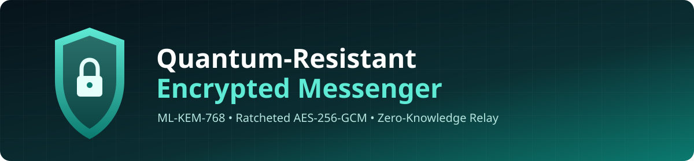
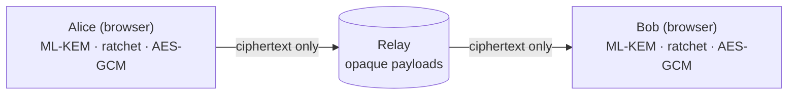
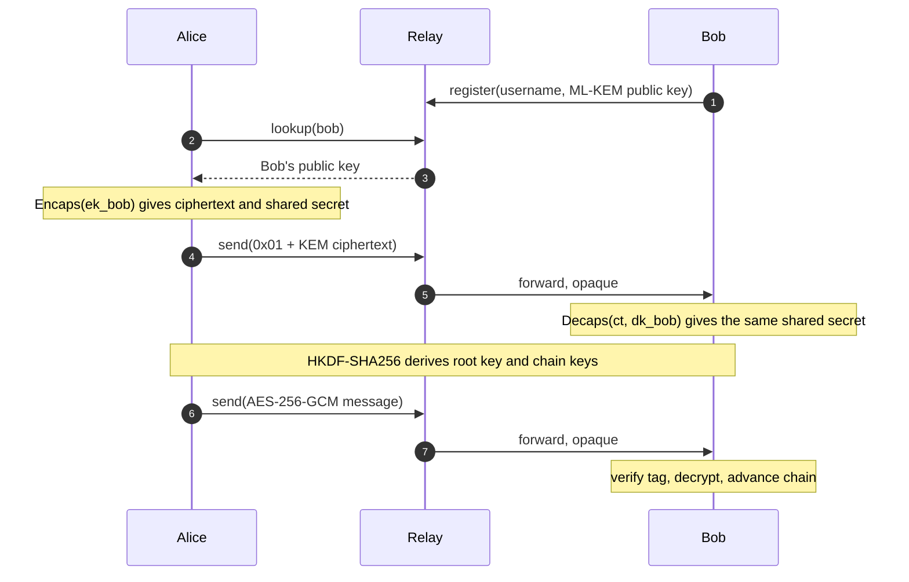
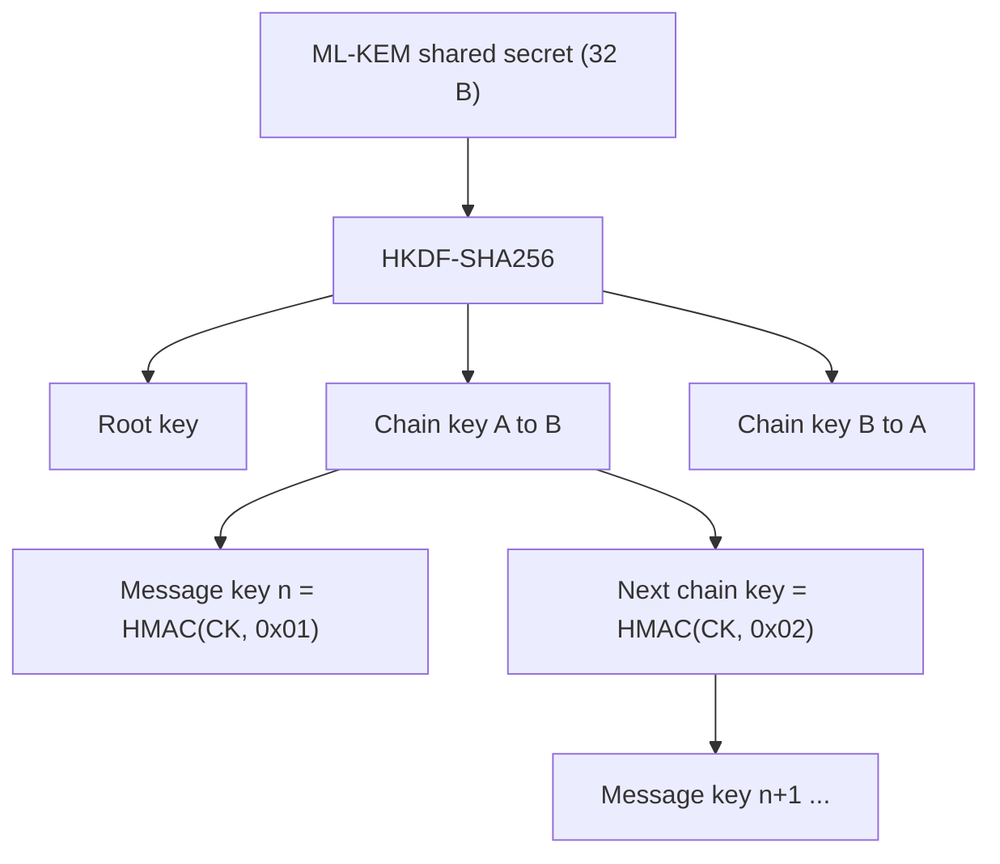

<p align="center">
  
</p>

<p align="center">
        
</p>

<p align="center">
  <b>End-to-end encrypted messaging that stays secure against future quantum computers.</b><br>
  Post-quantum key exchange, ratcheted message keys, a relay that cannot read anything, and a browser client that shows the cryptography working live.
</p>

<p align="center">
  <a href="#-at-a-glance">Overview</a> ·
  <a href="#-milestones">Milestones</a> ·
  <a href="#-architecture">Architecture</a> ·
  <a href="#-quick-start">Quick start</a> ·
  <a href="#-testing--verification">Testing</a> ·
  <a href="#-security-model">Security</a> ·
  <a href="#-limitations--roadmap">Roadmap</a>
</p>

---

## ✨ At a Glance

| | |
|---|---|
| 🔑 **Key exchange** | ML-KEM-768 (NIST FIPS 203), lattice-based, resists Shor's algorithm |
| 🔒 **Message encryption** | AES-256-GCM, unique key and random 96-bit IV for every message |
| 🔁 **Key ratchet** | HKDF-SHA256 root key, HMAC-SHA256 chain, old keys are overwritten |
| 🛰️ **Relay** | Forwards opaque ciphertext only. Rate-limited, replay-protected, queues for offline users |
| 🖥️ **Client** | Single-file browser app with live encryption metadata and a safety-number check |
| ✅ **Verified** | NIST ACVP known-answer tests, tamper and replay tests, Rust ↔ JS interoperability, wire-capture test |

## 🗺️ Milestones

| # | Milestone | Where | Status |
|:-:|-----------|-------|:------:|
| 1 | Post-Quantum Key Encapsulation (ML-KEM-768) | [`pq-kem`](pq-kem) | ✅ |
| 2 | Double Ratchet and AES-256-GCM Encryption | [`pq-kem`](pq-kem) | ✅ |
| 3 | Asynchronous WebSocket Relay Server | [`pq-relay`](pq-relay) | ✅ |
| 4 | Terminal & Web Interface with Security Verification | [`pq-web`](pq-web) | ✅ |

<details>
<summary><b>Milestone 1: Post-Quantum Key Encapsulation</b></summary>

<br>

- Generates ML-KEM-768 public and private keypairs
- Encapsulation and decapsulation produce an identical 256-bit shared secret
- Automated tests check keygen, encapsulation and decapsulation against the official **NIST ACVP** vectors (`pq-kem/tests/vectors/`)

</details>

<details>
<summary><b>Milestone 2: Double Ratchet & Symmetric Encryption</b></summary>

<br>

- Root key and chain key ratcheting: every message gets its own key, then the chain key is overwritten
- AES-256-GCM with a unique random IV per message
- The message counter is authenticated as additional data, so tampering, replay and reordering are rejected
- A message that fails authentication does **not** advance the chain
- `ratchet_root()` mixes in a fresh KEM secret to reset the chains

</details>

<details>
<summary><b>Milestone 3: Asynchronous WebSocket Relay</b></summary>

<br>

- Handshake with public-key discovery (`register`, `lookup`, `send`)
- Ephemeral offline queues: memory only, 100 messages and 5 minutes per user, deleted once delivered
- Token-bucket rate limiting (burst 10, 5 msg/s) with disconnect after repeated violations
- Replay cache on `(from, to, id)`, payload size caps, username and key validation
- The relay treats payloads as opaque strings and never parses or decrypts them

</details>

<details>
<summary><b>Milestone 4: Terminal & Web Interface with Security Verification</b></summary>

<br>

- Interactive chat UI showing live encryption metadata: nonce, auth tag, ciphertext size, message number, key fingerprints
- Safety numbers for out-of-band verification, plus a "Send tampered" button that demonstrates MAC rejection
- Panel showing exactly what the relay sees on the wire
- Network-capture proof of zero plaintext leakage ([Wireshark guide](pq-web/docs/WIRESHARK.md))
- [Cryptographic architecture and threat model](pq-web/docs/ARCHITECTURE.md)

</details>

## 🏗️ Architecture



### Handshake and messaging



### Key schedule



### Wire format

```text
Handshake : 0x01 ‖ ML-KEM ciphertext (1088 B)
Message   : 0x02 ‖ n (4 B) ‖ nonce (12 B) ‖ AES-256-GCM ciphertext ‖ tag (16 B)
            AAD = n          key = fresh message key       payload is hex inside JSON
```

| Parameter | Size |
|-----------|------|
| ML-KEM-768 public key | 1184 B |
| ML-KEM-768 secret key | 2400 B |
| KEM ciphertext | 1088 B |
| Shared secret | 32 B (256 bit) |
| AES-GCM IV / tag | 12 B / 16 B |

Full details: [`ARCHITECTURE.md`](pq-web/docs/ARCHITECTURE.md)

## 📦 Repository Structure

```text
pq-messenger/
├── pq-kem/        Milestones 1-2: ML-KEM-768, ratchet, AES-256-GCM (Rust)
│   ├── src/       lib.rs (ratchet), main.rs (demo)
│   └── tests/     NIST KAT, ratchet, roundtrip, vectors/
├── pq-relay/      Milestone 3: WebSocket relay (Rust, Tokio)
│   ├── src/       lib.rs (server), main.rs
│   └── tests/     integration tests
├── pq-web/        Milestone 4: browser client (JavaScript)
│   ├── dist/      index.html (single-file app, no install needed)
│   ├── src/       crypto.js, client.js, app.js
│   └── docs/      ARCHITECTURE.md, WIRESHARK.md
└── docs/          banner.svg
```

## 🚀 Quick Start

**Prerequisites:** [Rust](https://rustup.rs) (stable). On Windows also install *Build Tools for Visual Studio* with **Desktop development with C++**. Node.js 18+ is only needed for the JavaScript tests.

```bash
git clone https://github.com/harisaravananm/pq-messenger.git
cd pq-messenger
```

**1. Crypto core (Milestones 1 and 2)**
```bash
cd pq-kem
cargo test     # NIST KAT, ratchet, tamper tests
cargo run      # prints a 256-bit shared secret
```

**2. Relay (Milestone 3)**
```bash
cd pq-relay
cargo test     # handshake, queue, replay, rate limit
cargo run      # listening on ws://127.0.0.1:9001
```

**3. Chat client (Milestone 4)**

With the relay running, open `pq-web/dist/index.html` in **two browser tabs**:

1. Enter a different username in each tab and click **Connect**
2. In one tab, type the other username under *Chats* and click **Start**
3. Send messages and click any bubble to inspect its encryption metadata
4. Click **Send tampered** to watch the MAC check reject a corrupted message
5. Compare the **safety number** in both tabs; they must match

## 🧪 Testing & Verification

| Suite | Command | Checks |
|-------|---------|:------:|
| NIST known-answer vectors | `cargo test` in `pq-kem` | 3 |
| Ratchet, tamper, replay, roundtrip | `cargo test` in `pq-kem` | 11 |
| Relay unit and integration | `cargo test` in `pq-relay` | 8 |
| End-to-end and wire capture | `node test-e2e.mjs` in `pq-web` | 10 |
| Rust ↔ JavaScript interoperability | `node test-interop.mjs` in `pq-web` | 1 |

The end-to-end test routes traffic through a sniffing proxy, proves the plaintext never appears on the wire, and includes a **negative control** (a deliberately unencrypted payload *is* detected) so the check cannot pass vacuously.

### Wireshark: zero plaintext leakage

Capture on the loopback adapter with `tcp port 9001`, send the phrase `TOP-SECRET-PLAINTEXT-4242`, then apply:

| Display filter | Expected result |
|----------------|-----------------|
| `frame contains "TOP-SECRET-PLAINTEXT-4242"` | 0 packets |
| `websocket.payload.text contains "TOP-SECRET"` | 0 packets |
| `websocket.payload.text contains "payload"` | packets showing hex ciphertext only |

Step-by-step: [`WIRESHARK.md`](pq-web/docs/WIRESHARK.md)

## 🛡️ Security Model

| Party | Can see | Cannot see |
|-------|---------|------------|
| Network observer | usernames, public keys, message sizes and timing, ciphertext | message content, session keys |
| Relay operator | the above, plus who talks to whom | message content, session keys |
| Chat partner | messages sent to them | other conversations |

| Threat | Defense |
|--------|---------|
| Harvest now, decrypt later | ML-KEM-768 key exchange and AES-256 |
| Message tampering | GCM tag, counter authenticated as AAD |
| Replay and reordering | Strict counter check plus relay replay cache |
| Spam and queue flooding | Token bucket, disconnect on abuse, size and queue caps |
| Relay swapping public keys | Safety-number comparison out-of-band |

Ten threats with residual risks: [`ARCHITECTURE.md`](pq-web/docs/ARCHITECTURE.md#7-threat-model)

## ⚠️ Limitations & Roadmap

> This is an educational project. It has **not** been independently audited. Do not use it to protect real secrets.

- [ ] **Sender authentication:** registration is unauthenticated, so anyone who knows a public key can register as that user while they are offline (fix: ML-DSA signatures or a KEM challenge at registration)
- [ ] **Forward secrecy against key leakage:** the handshake targets a static key (fix: signed ephemeral prekeys, PQXDH-style)
- [ ] **Automatic root ratchet** with a fresh KEM exchange per conversation turn
- [ ] **`wss://` transport:** the demo uses plain `ws://`, so metadata is visible on the network
- [ ] **Encrypted key storage:** the demo UI keeps the private key in `localStorage`
- [ ] Out-of-order message buffering and a terminal client

## 🧰 Tech Stack

| Layer | Technology |
|-------|-----------|
| Post-quantum KEM | RustCrypto `ml-kem` (Rust), `@noble/post-quantum` (JavaScript) |
| Symmetric crypto | `aes-gcm`, `hkdf`, `hmac`, `sha2` (Rust), WebCrypto (browser) |
| Relay | Tokio, `tokio-tungstenite`, Serde |
| Client | Vanilla JavaScript, bundled with esbuild into one HTML file |
| Verification | NIST ACVP vectors, Node.js `ws` sniffing proxy, Wireshark |

## 📚 References

- [NIST FIPS 203: Module-Lattice-Based Key-Encapsulation Mechanism (ML-KEM)](https://csrc.nist.gov/pubs/fips/203/final)
- [NIST ACVP test vectors](https://github.com/usnistgov/ACVP-Server)
- [RFC 5869: HKDF](https://www.rfc-editor.org/rfc/rfc5869)
- [Signal Double Ratchet specification](https://signal.org/docs/specifications/doubleratchet/)

## 👤 Author

**Hari Saravanan M**: [GitHub](https://github.com/harisaravananm) · [LinkedIn](https://linkedin.com/in/hari-saravanan-m-) · [Portfolio](https://harisaravananm.github.io/Myportfolio)

## 📄 License

[MIT](LICENSE)


